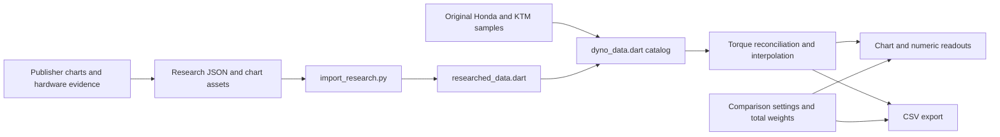

# Application architecture

DynoLab runs entirely in the browser. Flutter renders the comparison controls and a custom-painted chart; the dataset, source images, and fonts ship with the static release. Cloudflare serves files and handles the hostname. It does not calculate curves or store user comparisons.

## Code map

| File or directory | Responsibility |
| --- | --- |
| [`lib/main.dart`](../lib/main.dart) | Entry point, theme, comparison state, selection cards, weight inputs, dialogs, persistence, Copy link, and CSV export |
| [`lib/library_dialog.dart`](../lib/library_dialog.dart) | Search, category filters, editorial collections, source-only status, and adding a configuration |
| [`lib/dyno_data.dart`](../lib/dyno_data.dart) | Domain models, original Honda/KTM data, units, torque reconciliation, interpolation, peaks, weights, and combined catalog |
| [`lib/researched_data.dart`](../lib/researched_data.dart) | Generated typed bikes, configurations, weights, and editorial picks; edit its inputs instead |
| [`lib/dyno_chart.dart`](../lib/dyno_chart.dart) | Chart projection, axes, curves, cursor, per-curve labels, pointer/touch/keyboard input, and normalization |
| [`lib/value_format.dart`](../lib/value_format.dart) | Three-significant-figure measurements, RPM grouping, and measurements embedded in prose |
| [`lib/share_state.dart`](../lib/share_state.dart) | Compact comparison serialization, validation, and URL construction |
| [`lib/share_catalog.dart`](../lib/share_catalog.dart) | Permanent numeric configuration and weight-reference codebooks |
| [`lib/platform/`](../lib/platform/) | Browser-specific storage, history, clipboard, downloads, and a no-op test implementation |
| [`scripts/`](../scripts/) | Data generation, later sampling-ledger replay, numerical audit, share-size report, and local static preview |
| [`test/`](../test/) | Domain, chart, layout, library, input, sharing, and persistence tests |
| [`web/`](../web/) | Root HTML, loading shell, title, manifest, favicon, and Flutter web entry resources |
| [`assets/`](../assets/) | Bundled publisher chart evidence and Manrope font/license |
| [`docs/`](README.md) | Research inputs, provenance notes, audit outputs, and maintainer guides |
| [`wrangler.jsonc`](../wrangler.jsonc) | Cloudflare static-asset directory, SPA fallback, account, and custom domain |

`library_dialog.dart` is a Dart `part` of `main.dart`; `researched_data.dart` is a `part` of `dyno_data.dart`. They share the parent library's imports and private names. They are not independent import targets. A future separation into libraries needs explicit imports and public interfaces.

## Data flow

The original chart image, recorded samples, reconciled samples, and reported publisher peaks serve different purposes. Keep them distinct. See [data workflow](data-workflow.md) for the numerical rules and evidence requirements.

## Domain model

### Bike, model weight, and tested configuration

- `Bike` identifies a selectable engine/model family and supplies its display identity. A family can have multiple tested configurations and weight presets.
- `WeightPreset` identifies a model/equipment mass, its pound value, basis, and source URL. Choosing a Rally, ABS, Adventure, or Enduro weight changes the denominator only.
- `Configuration` identifies an actual stock or modified published run, including parts, model-year context, measurement basis, reported peaks, notes, and a `DynoSource`.
- `DynoSource` carries the publisher page, original chart URL, bundled chart asset, digitization method, and caveats.
- `DynoPoint` stores `rpm`, mechanical horsepower, and torque in N·m. UI torque is converted to lb-ft.
- `EditorialPick` selects a configuration and optionally a model weight for a named collection. It is an editorial inclusion, not a sales rank.
- `Selection` is one user's comparison card: configuration, weight preset/custom mass, and local visibility. Multiple cards can use the same bike or configuration with independent weights.
- `ChartRun` is the plotting view of a visible selection, with the position-based color/letter and total denominator.

A configuration can retain provenance without a curve. `hasCurve` is derived from at least two reconciled points; it is not enabled by a JSON marketing claim such as `hasCurve: true`. Source-only entries have no drawable samples and cannot be added to the chart.

The model includes optional `baselineConfigId` and `gainSummary` metadata for identifying a documented baseline. Source details display the gain description and can open that baseline. Generated `tuneResearch` notes summarize family-level research outcomes, including evidence that remains unavailable. A textual gain summary is evidence context; it must not manufacture an RPM curve or establish a controlled comparison between unrelated tests.

### Stored and derived numerical data

`Configuration.recordedPoints` is an immutable copy of the input samples. The lazy `points` property applies `TorqueReconciliation` once and returns an immutable derived list. `Configuration.at(rpm)` interpolates derived torque, then calculates horsepower. It returns `null` outside the source range. `peakHp` considers both sample points and internal maxima of the resulting quadratic segments.

Changing weight, display mode, or cursor position does not edit the dataset. A family weight preset does not prove that every tested engine/body variant has the same output.

## App state and persistence

`DynoLabApp` creates a themed `MaterialApp` with `initialRoute: '/'`. `ComparisonPage` owns application state using `StatefulWidget` / `setState`, with no external state-management package.

At startup:

1. Read the single URL path segment and try to decode a comparison.
2. Restore valid shared settings in preference to saved browser settings.
3. Otherwise load the `dynolab-v1` local-storage snapshot, leaving defaults available when storage is absent or unavailable.
4. Present any locally restored panel after the first frame.
5. Save the snapshot and canonical comparison path.

State changes save through `save()`. Library search/category changes use a 180 ms debounce. Copy link calls `save()` first so pending changes are flushed. Browser history uses `replaceState`, so each adjustment replaces the current entry. A `popstate` listener restores a valid comparison when history navigation changes it.

| State | Shared path | Local snapshot |
| --- | --- | --- |
| Ordered configurations and their weights | Yes | Yes |
| Preset selection / custom weight | Yes | Yes |
| Both / Power / Torque | Yes | Yes |
| Per-100-pound mode | Yes | Yes |
| Rider/gear values and inclusion toggle | Yes | Yes |
| Per-card visibility | No; all included runs are visible when shared | Yes |
| Library query/category and source/panel navigation | No; shared links open comparison | Yes |
| Colors | Derived from card position | Derived from card position |
| Torque units | Always lb-ft | No selectable unit setting |
| Cursor RPM, scroll, temporary menus, unfinished input | No | No |

Local preferences are a fallback, not an overlay on valid shared settings. For example, opening a valid comparison link does not restore a saved hidden card or open library. A normal reload after the app writes its own path also follows this shared-state precedence.

Invalid state is silently ignored. On initial load this falls back to saved/default settings; during `popstate`, invalid state leaves the current comparison alone. The encoder writes only comparison fields from the wider snapshot. Its in-memory `version` field is not a wire-format version byte. The [sharing specification](compact-sharing.md) defines the actual current layout.

### Browser boundary

`platform/browser.dart` conditionally exports the real implementation when `dart.library.js_interop` is available. Web code uses `package:web` and `dart:js_interop`, so it remains compatible with Wasm compilation. Native Dart/widget tests receive `browser_stub.dart` and cannot prove real clipboard, browser history, or storage behavior.

`browser_web.dart` owns access to `localStorage`, `location`, `history.replaceState`, `popstate`, Clipboard API, external links, and CSV downloads. Clipboard failure falls back to a selectable-link dialog. Local storage failure is tolerated; the application does not require cookies or login.

## Chart behavior

The chart uses Flutter `CustomPaint`, not an external charting package. All visible bikes share an RPM domain, a power scale, and a separate torque scale. Do not read a crossing of lines on differently scaled power/torque axes as a physical equality.

- Torque is drawn as linear segments in the selected physical scale, with a dashed stroke.
- Horsepower is drawn as quadratic Bézier segments that exactly represent linear torque multiplied by RPM, with a solid stroke.
- Axis limits expand for selected source ranges and peaks; higher-revving models must not be clipped to the original Honda/KTM range.
- A mouse hover, touch tap/drag, or arrow-key movement sets one RPM for all visible curves.
- The vertical marker stays at the last position. Per-curve markers/readouts use `Configuration.at(rpm)`; curves outside their domain have no numerical value at that RPM.
- Label placement separates nearby readouts to reduce overlap. Adding curves must preserve readability on narrow screens.
- Arrow keys move by 100 RPM while the graph is focused. Semantics expose the current graph position to assistive technology.

The Per 100 lb toggle scales both metrics by the same `100 / totalWeightLb` factor. Power and torque keep their separate shared axes. It does not change source samples, engine RPM, gearing, or curve shape within a run.

## Input and display precision

All calculations use stored numerical precision; most displayed measurements and CSV values use `formatValue` with three significant figures. Source images and identifying model/year text are not rewritten. RPM display adds separators.

Rider and gear entry fields are an intentional exception: new entries are rounded to whole pounds, and the inputs display no decimal places. The sharing codec can still preserve a valid fractional value supplied programmatically. Bike weight entry accepts positive finite decimals and preserves the last valid value during invalid edits. Rider and gear permit zero. Disabling load retains its entered values for later re-enabling.

Keep formatting separate from calculations. Do not parse a rounded card label back into a model weight or use chart-coordinate rounding to regenerate samples.

## CSV export

Export is generated client-side in `ComparisonPage.export()` and downloaded as `dynolab-comparison.csv`. It includes publisher/source context, the approximation method, load inclusion, rider/gear weights, bike and total weights, and both raw and normalized metrics. It samples at 100 RPM intervals over the current chart domain, emits blanks outside a configuration's source range, quotes cells, and uses CRLF line endings.

Export includes selected configurations even when a card is locally hidden; the current domain comes from visible chart runs. CSV is a presentation export rounded to three significant figures. Use the [full-precision audit JSON](dyno-consistency-audit.json) or original research data for numerical maintenance.

## Hosting boundaries and extension points

Cloudflare serves `build/web`. SPA fallback is needed for direct comparison paths, and the root base URL is needed for loading assets from those paths. There is no server route for each comparison. See [deployment](deployment.md).

Useful future refactoring boundaries are the selection/persistence controller, CSV generation, source details UI, and the generated research model. Preserve the current public behavior and physical invariants when extracting them. Adding user accounts, remotely editable data, or persistent short-link storage would introduce a new service and is outside the current architecture.
